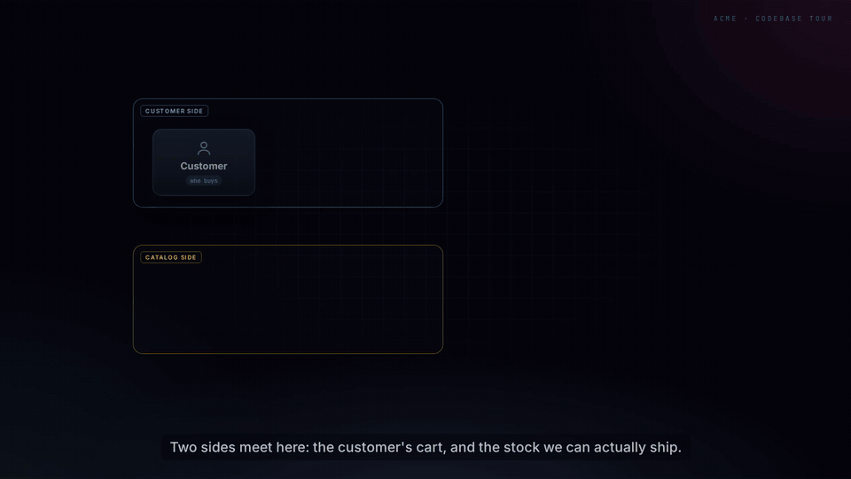
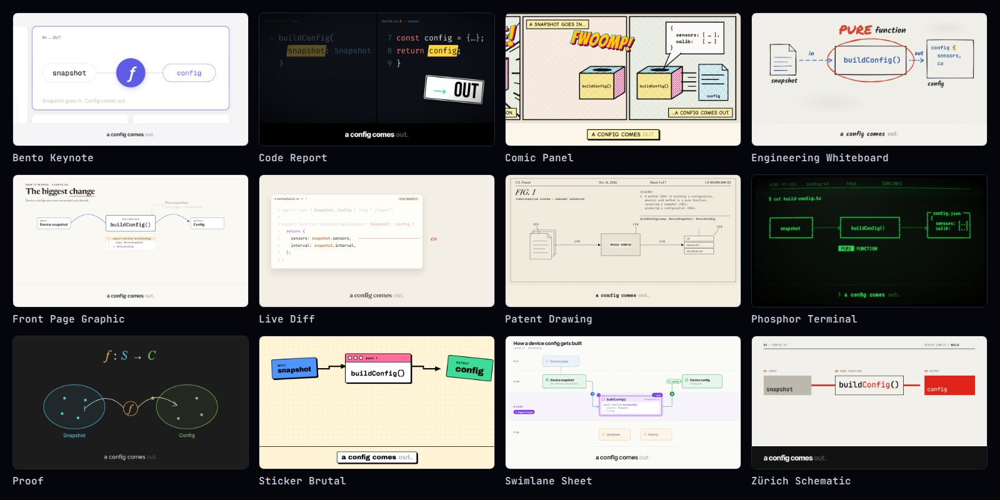

<p align="center">
  <picture>
    <source media="(prefers-color-scheme: dark)" srcset="docs/banner-dark.png">
    <source media="(prefers-color-scheme: light)" srcset="docs/banner-light.png">
    
  </picture>
</p>

<p align="center">
  <strong>Explain your code in a video.</strong><br />
  Claude reads the code, writes the script, animates it and renders an MP4.
</p>

<p align="center">
  <a href=".claude-plugin/plugin.json"></a>
  <a href="LICENSE"></a>
  <a href="https://code.claude.com/docs/en/plugins"></a>
  
</p>

<p align="center">
  <a href="#install">Install</a> ·
  <a href="#how-it-works">How it works</a> ·
  <a href="#styles">Styles</a>
</p>

<p align="center">
  <a href="docs/demo.mp4"></a>
</p>

<p align="center"><a href="docs/demo.mp4">Watch the 47-second sample with sound</a></p>

## Install

```
/plugin install codebase-explainer-video --marketplace DixitRam/codebase-explainer-video
```

Then ask:

> Make an explainer video of how checkout works.

**You need:** Node 18+ (22+ for alternative styles), `ffmpeg`, Playwright and a `GEMINI_API_KEY` for the voice. Gemini bills your key.

## How it works

1. **Research:** reads the flow and notes `file:line` for each claim.
2. **Script:** one idea per spoken line.
3. **Build:** system map, real screenshots, code cards.
4. **Check:** reviews key frames before paying for voice.
5. **Render:** voice, subtitles, sound effects, MP4.
6. **Verify:** checks the final video matches the words.

## Styles

Dark system map by default, plus 13 alternatives. [See them all.](skills/codebase-explainer-video/styles/README.md)

<p align="center"></p>

## Good to know

- **Fast:** renders in parallel. A 6:21 video took 5m 42s on a 12-thread laptop, down from about 13 minutes. Set `WORKERS=8` to use more.
- **Check your screenshots:** videos can show real app data. Use test data and look before sharing.

## License

[MIT](LICENSE). Sound effects are CC0 by [Kenney](https://kenney.nl). Styles credit their inspirations in [`styles/`](skills/codebase-explainer-video/styles/README.md). Not affiliated with them, Anthropic or Google.
